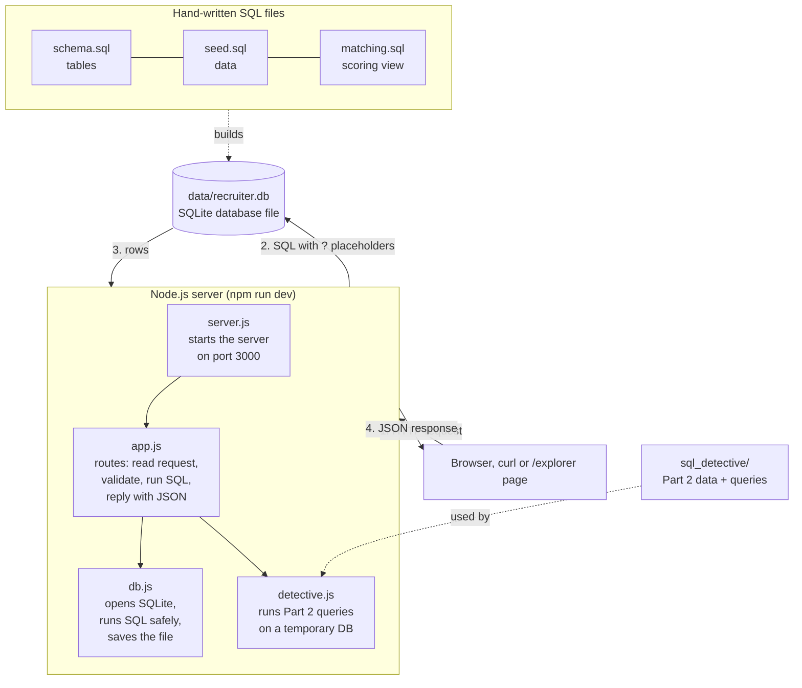
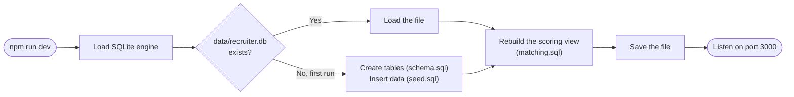
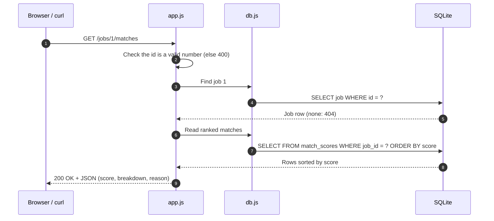
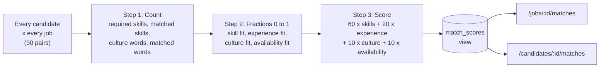
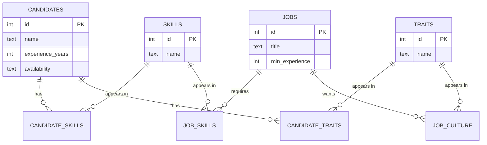
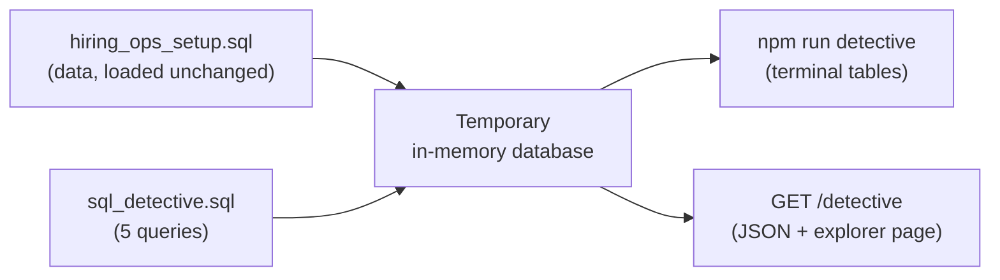

# Recruiter Bot: Candidate and Job Matching Backend

A backend service that matches job candidates to job openings, built with Node.js, Express and SQLite using only hand-written SQL (no ORM). It ranks the best candidates for each job and the best jobs for each candidate, with a score and a plain-English reason, and includes the SQL Detective queries for Part 2.

---

## How to run it

### Requirements

- **Node.js 18.18 or newer** (download the LTS version from https://nodejs.org). Check your version with:

```bash
node --version
```

No database server is needed. SQLite runs inside the project and stores everything in one file.

### Step 1: Get the project

**Option A: clone with Git**

```bash
git clone https://github.com/<your-username>/RecruitFlow_BackEndDeveloper_RecruiterBot.git
cd RecruitFlow_BackEndDeveloper_RecruiterBot
```

**Option B: download the ZIP**

On the GitHub page, click **Code → Download ZIP**, extract it, then open a terminal inside the extracted folder:

```bash
cd RecruitFlow_BackEndDeveloper_RecruiterBot-main
```

### Step 2: Install and start

```bash
npm install
npm run dev
```

When it starts you will see:

```text
Recruiter Bot running at http://localhost:3000
Explorer page: http://localhost:3000/explorer
```

Leave this terminal running.

### Step 3: Open it in the browser

| URL | What you see |
|---|---|
| http://localhost:3000/explorer | A simple page with dropdowns to try everything (recommended) |
| http://localhost:3000/jobs/1/matches | Best candidates for job 1, as JSON |
| http://localhost:3000/candidates/1/matches | Best jobs for candidate 1, as JSON |
| http://localhost:3000/detective | All Part 2 (SQL Detective) answers, as JSON |
| http://localhost:3000/ | A list of every available endpoint |

### Other useful commands

Run these in a **second** terminal while the server is running:

```bash
npm test
npm run detective
npm run seed
```

- `npm test`: runs 13 automated tests (uses a temporary database, so your data is never touched)
- `npm run detective`: prints the Part 2 answers as tables in the terminal
- `npm run seed`: resets the database to the original 15 candidates and 6 jobs

### Trying it with curl

On Windows PowerShell, type `curl.exe` (plain `curl` is a different command there):

```bash
curl.exe http://localhost:3000/jobs/1/matches
curl.exe "http://localhost:3000/jobs/4/matches?available_only=true&limit=3"
curl.exe http://localhost:3000/candidates/12/matches
curl.exe -X POST http://localhost:3000/candidates -H "Content-Type: application/json" --data "@examples/new-candidate.json"
curl.exe -X POST http://localhost:3000/jobs -H "Content-Type: application/json" --data "@examples/new-job.json"
```

---

## What this project is

### Goal

Help a recruiter answer two questions quickly, and explain every answer:

- *"Who are the best candidates for this job?"*
- *"Which jobs suit this candidate best?"*

### Objectives

- Store 15 candidates and 6 jobs in a relational database designed from scratch.
- Write every table and every query by hand in SQL. No ORM or query builder is used.
- Score every candidate against every job from **0 to 100**, using skills, experience, culture fit and availability.
- Give each score a **short, readable reason**, so it is never a mystery number.
- Answer five data questions about a separate, slightly messy hiring dataset (Part 2: SQL Detective).

### What it does

- **Loads the data.** On first start, it builds the database and fills it with the 15 candidates and 6 jobs.
- **Ranks candidates for a job.** `GET /jobs/{id}/matches` returns candidates from best to worst fit.
- **Ranks jobs for a candidate.** `GET /candidates/{id}/matches` does the reverse.
- **Explains every score.** Each result includes the points per factor, matched and missing skills, and a one-line reason.
- **Accepts new data.** `POST /candidates` and `POST /jobs` add people and jobs, who are scored immediately.
- **Answers Part 2.** `GET /detective` runs the five SQL Detective queries.
- **Includes a viewing page.** `/explorer` is a plain HTML page that calls the same endpoints and shows the results as tables and JSON. It is a demo aid, not a frontend.

---

## How it works

### Backend architecture



### What happens when the server starts



### What happens on a request: `GET /jobs/1/matches`



### The matching algorithm

All scoring happens in **one SQL view** (`db/matching.sql`) that scores every candidate–job pair. Both match endpoints read from this same view, so the two directions always agree.



| Factor | Points | How it is measured |
|---|---|---|
| Skills | up to 60 | Required skills the candidate has ÷ total required skills |
| Experience | up to 20 | Full points if years ≥ minimum, otherwise partial (years ÷ minimum) |
| Culture | up to 10 | Job culture keywords found in the candidate's traits ÷ total keywords |
| Availability | up to 10 | Immediate = 10, 2 weeks = 5, Not looking = 0 |

**Example: Sherlock H. for "Backend Detective".** He has all 3 required skills (60), 8 years against 3 needed (20), 1 of 2 culture words (5), and is available immediately (10), for a total of **95**.

```json
{
  "candidate_name": "Sherlock H.",
  "score": 95,
  "breakdown": { "skills": 60, "experience": 20, "culture": 5, "availability": 10 },
  "matched_skills": ["deduction", "pattern-recognition", "forensics"],
  "missing_skills": [],
  "reason": "Skills 3/3 (deduction, pattern-recognition, forensics); 8 yrs (needs 3+); culture fit: analytical; available immediately"
}
```

### Database design

Skills and traits are stored once each, in "dictionary" tables. Link tables connect them to candidates and jobs, so finding overlap is a simple join.



### Part 2: SQL Detective



| Question | Answer |
|---|---|
| Q1: Open postings with recruiter name | Postings 1, 2, 4, 5 |
| Q2: Applicants who reached the Final stage, per posting | 2, 2, 1, 2, 0, 0, 2 |
| Q3: People who applied to more than one posting | Ananya Rao, Ben Turner, Elena Popescu |
| Q4: Final-stage conversion rate (at least 3 Finals) | Priya Shah 0.75, Daniel Ortiz 0.50 |
| Q5: Top recruiter per department (window function) | Data: Fatima Al-Sayed, Engineering: Priya Shah |

Key trap handled: **Ananya Rao has two applicant records** whose emails differ only in capital letters, so people are identified by `LOWER(TRIM(email))`, not by id.

---

## Folder structure

```text
RecruitFlow_BackEndDeveloper_RecruiterBot/
├── db/
│   ├── schema.sql              # creates the 8 tables
│   ├── seed.sql                # inserts the 15 candidates and 6 jobs
│   └── matching.sql            # the scoring algorithm (one SQL view)
├── src/
│   ├── server.js               # entry point: opens the DB, starts the server
│   ├── app.js                  # all routes (URLs), validation, JSON replies
│   ├── db.js                   # database connection + safe query helpers
│   └── detective.js            # runs the Part 2 queries for the web
├── scripts/
│   ├── seed.js                 # npm run seed: rebuilds the database
│   └── run-detective.js        # npm run detective: prints Part 2 answers
├── sql_detective/
│   ├── hiring_ops_setup.sql    # Part 2 dataset (unchanged from the brief)
│   └── sql_detective.sql       # Part 2 answers: Q1 to Q5
├── public/
│   └── explorer.html           # simple browser page for trying the API
├── tests/
│   └── api.test.js             # 13 automated tests
├── examples/
│   ├── new-candidate.json      # sample body for POST /candidates
│   └── new-job.json            # sample body for POST /jobs
├── data/                       # recruiter.db is created here on first run
├── package.json                # dependencies and npm commands
├── package-lock.json           # exact installed versions (auto-generated)
└── README.md
```

| File | Responsible for |
|---|---|
| `db/schema.sql` | Table design: candidates, jobs, the skills and traits dictionaries, and four link tables, with constraints and indexes |
| `db/seed.sql` | Loading the assignment's candidates, jobs, skills, traits and culture keywords |
| `db/matching.sql` | Calculating the 0–100 score and reason for every candidate–job pair |
| `src/server.js` | Starting everything: opens the database, then listens on port 3000 |
| `src/app.js` | Every endpoint: reading input, validating it, querying, and replying with JSON or errors |
| `src/db.js` | The only file that talks to SQLite: opening, saving, and the `all` / `get` / `run` helpers with `?` placeholders |
| `src/detective.js` | Running the five Part 2 queries on a temporary database and returning JSON |
| `scripts/seed.js` | Resetting the database to the original data (the ingestion script) |
| `scripts/run-detective.js` | Printing the Part 2 answers as tables in the terminal |
| `sql_detective/*.sql` | Part 2 dataset and the five answer queries |
| `public/explorer.html` | A plain viewing page with dropdowns. It only calls the API endpoints |
| `tests/api.test.js` | Automated checks of scoring, ranking, filters, errors, POST endpoints and Part 2 |
| `examples/*.json` | Ready-made request bodies for the POST endpoints |
| `package.json` | Project info, the two dependencies (`express`, `sql.js`) and the npm commands |

Every source file contains detailed line-by-line comments explaining what each part does and why.

---

## API reference

| Method | Endpoint | Description |
|---|---|---|
| GET | `/jobs/{id}/matches` | Ranked candidates for a job. Options: `?limit=10`, `?available_only=true` |
| GET | `/candidates/{id}/matches` | Ranked jobs for a candidate. Option: `?limit=10` |
| GET | `/jobs`, `/jobs/{id}` | List jobs / one job with skills and culture keywords |
| GET | `/candidates`, `/candidates/{id}` | List candidates / one candidate with skills and traits |
| POST | `/candidates` | Add a candidate (see `examples/new-candidate.json`) |
| POST | `/jobs` | Add a job (see `examples/new-job.json`) |
| GET | `/detective`, `/detective/{n}` | Part 2 answers: all five, or question n (1 to 5) |
| GET | `/explorer` | Browser page for trying the API |

Status codes: `200` OK, `201` created, `400` invalid input, `404` not found, `409` already exists.

---

## Design decisions and trade-offs

**Schema.** Skills and traits are stored in dictionary tables (`skills`, `traits`) linked to candidates and jobs through many-to-many tables. A comma-separated column would need fragile `LIKE` matching and could not be indexed or protected by foreign keys. With link tables, skill overlap is a plain `JOIN` on `skill_id`. Candidate traits and job culture keywords are the same kind of word, so both point at one shared `traits` table, which is what lets them be compared. Constraints (`UNIQUE`, `CHECK`, foreign keys) protect the data at the database level.

**Matches as a view.** A match is a SQL view (`match_scores`), not a stored table. It is calculated when read, so new candidates and jobs are matched immediately with no recompute step. At 90 pairs this costs nothing. At a much larger scale, I would materialise scores into an indexed table and score only candidates who share at least one skill with the job, instead of cross-joining everyone.

**The algorithm.** Skills carry 60% of the score because a recruiter cannot hire someone who cannot do the job. Experience is the brief's other must-have, at 20%, with partial credit when a candidate is slightly under the minimum. Culture and availability (10% each) are softer signals that mainly separate candidates with similar skills. Candidates with no shared skill are not returned. "Not looking" candidates are ranked lower rather than removed, because passive candidates still matter to recruiters, and `?available_only=true` hides them. Over-qualification is not penalised, since that is a business decision a recruiter should make on purpose. Culture matching is exact ("calm" does not match "calm-under-pressure") to avoid false positives; a synonyms table would be the next step. Ties are broken by matched skills, then experience, then id, so results are always in the same order.

**Other choices.** SQLite via `sql.js` needs no database server or native build tools, so `npm install` works the same on any machine; for production I would use PostgreSQL. Every user value goes through `?` placeholders to prevent SQL injection. POST requests are validated, and run inside a transaction so a failure never leaves half-saved data.

---

## Use of AI tools

<!-- Rewrite this section in your own words before submitting. Keep it truthful. -->

I used Claude (Anthropic) as a coding assistant. It generated the first version of the schema, the Express routes, the matching view, the SQL Detective queries and the documentation. I then ran every query, checked the SQL Detective results against the raw data by hand, tested the API with curl and the automated tests, and studied each file until I could explain every line and every scoring decision.
